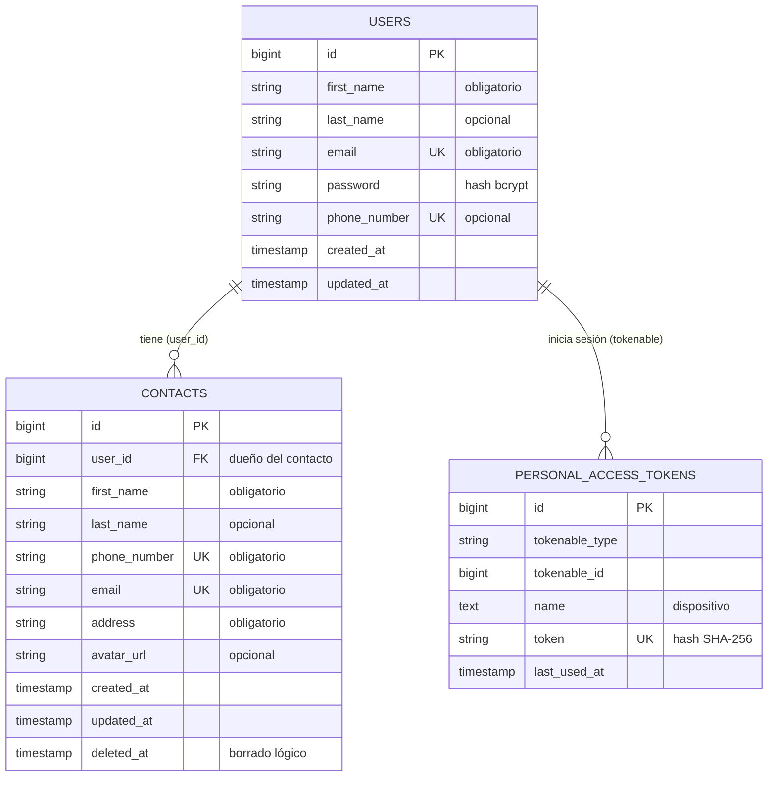

# Modelo de datos de Contacts API

- Un usuario tiene muchos contactos; cada contacto pertenece a un solo usuario.
- `contacts.email` y `contacts.phone_number` son únicos en toda la tabla,
  incluidos los contactos eliminados (el borrado es lógico y se pueden restaurar).
- El nombre y la dirección sí se pueden repetir.
- Si se elimina un usuario (de verdad), sus contactos se van con él (`ON DELETE CASCADE`).
